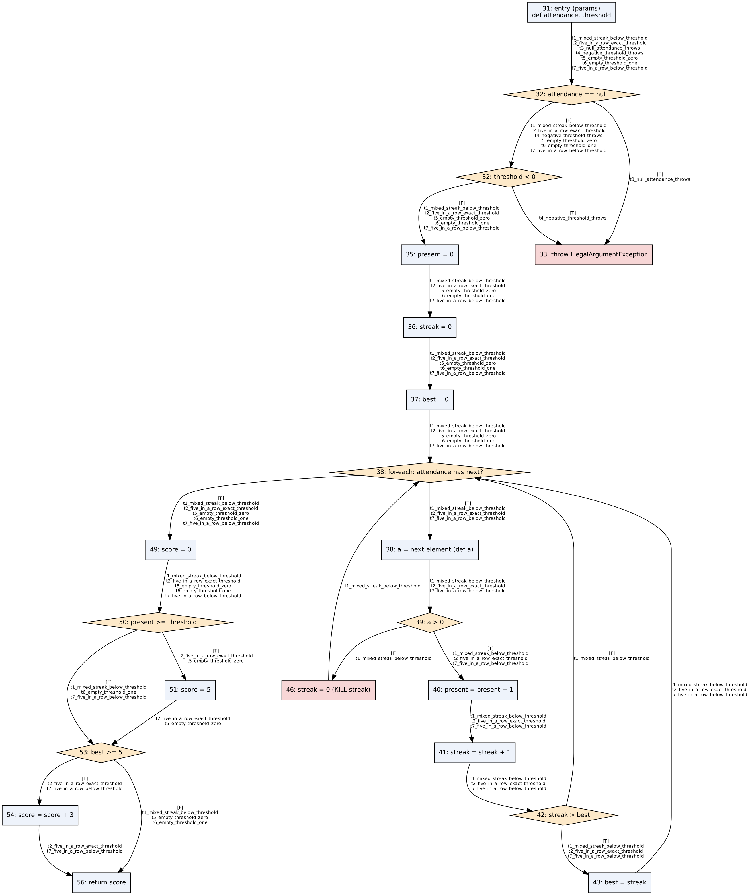

# Лаборатори №10: Өгөгдлийн урсгалын тест — Definition-Use хосууд

F.CSA313 — Программ хангамжийн чанарын баталгаа ба тест (2026)

- **Нэр:** Мөнх-Оргил
- **Оюутны код:** B242270130

## Орчин

```
openjdk version "17.0.20.1" 2026-08-18
OpenJDK Runtime Environment (build 17.0.20.1+1-1-26.04-Ubuntu)
OpenJDK 64-Bit Server VM (build 17.0.20.1+1-1-26.04-Ubuntu, mixed mode, sharing)

Apache Maven 3.9.12
Maven home: /usr/share/maven
Java version: 17.0.20.1, vendor: Ubuntu, runtime: /usr/lib/jvm/java-17-openjdk-amd64
Default locale: en_US, platform encoding: UTF-8
OS name: "linux", version: "7.0.0-38-generic", arch: "amd64", family: "unix"
```

## Репогийн бүтэц

```
pom.xml
src/main/java/mn/edu/must/sqat/DataFlowTargets.java   (starter, өөрчлөөгүй)
src/test/java/mn/edu/must/sqat/GcdTest.java           (Хэсэг A)
src/test/java/mn/edu/must/sqat/BonusTest.java         (Хэсэг B, C)
cfg-bonus.png                                         (B1)
results/                                              (mvn болон JaCoCo гаралтууд)
```

## A: gcd — DU хосын бүрэн хүснэгт

Мөрийн дугаар нь `DataFlowTargets.java` файлын мөр (лекцийн 1→13, 3→15, 4→16, 5→17, 6→18, 8→20).

Def/Use жагсаалт:

| Мөр | Код | Def | c-use | p-use |
|---|---|---|---|---|
| 13 | `gcd(int x, int y)` | x, y | | |
| 14 | `int tmp;` | (зарлалт, def биш) | | |
| 15 | `while (y != 0)` | | | y |
| 16 | `tmp = x % y;` | tmp | x, y | |
| 17 | `x = y;` | x | y | |
| 18 | `y = tmp;` | y | tmp | |
| 20 | `return x;` | | x | |

p-use нь T/F хоёр салаа тусдаа хос болдог тул нийт **13 DU хос**.

| ID | Хувьсагч | Def мөр | Use мөр | Төрөл | Def-clear зам | Тестийн ID | Хамрагдсан |
|---|---|---|---|---|---|---|---|
| P1 | x | 13 | 16 | c-use | 13→15→16 | T1 | Тийм |
| P2 | x | 13 | 20 | c-use | 13→15→20 | T2 | Тийм |
| P3 | x | 17 | 16 | c-use | 17→18→15→16 | T1 | Тийм |
| P4 | x | 17 | 20 | c-use | 17→18→15→20 | T1 | Тийм |
| P5 | y | 13 | 15 | p-use (T) | 13→15→16 | T1 | Тийм |
| P6 | y | 13 | 15 | p-use (F) | 13→15→20 | T2 | Тийм |
| P7 | y | 13 | 16 | c-use | 13→15→16 | T1 | Тийм |
| P8 | y | 13 | 17 | c-use | 13→15→16→17 | T1 | Тийм |
| P9 | y | 18 | 15 | p-use (T) | 18→15→16 | T1 | Тийм |
| P10 | y | 18 | 15 | p-use (F) | 18→15→20 | T1 | Тийм |
| P11 | y | 18 | 16 | c-use | 18→15→16 | T1 | Тийм |
| P12 | y | 18 | 17 | c-use | 18→15→16→17 | T1 | Тийм |
| P13 | tmp | 16 | 18 | c-use | 16→17→18 | T1 | Тийм |

Def-clear: заасан замд тухайн хувьсагчийг дахин тодорхойлсон мөр байхгүй. Жишээ нь P8-д `y` нь 16-д зөвхөн уншигдана, 18 хүртэл дахин def хийгдэхгүй.

### Тестүүд (GcdTest.java; энд T1–T4 нь зөвхөн GcdTest-ийн тестүүд)

| Тест | Оролт | Хамарсан хос |
|---|---|---|
| T1 | gcd(12,8)=4 (2 давталт) | P1, P3, P4, P5, P7–P13 (11 хос) |
| T2 | gcd(7,0)=7 (0 давталт) | P2, P6 |
| T3 | gcd(0,5)=5 (1 давталт), нэмэлт | шаардлагагүй, 1 давталтын тохиолдол |
| T4 | gcd(48,18)=6 (3 давталт), нэмэлт | шаардлагагүй |

T1 + T2 нийлээд 13/13 хосыг хамарна.

**gcd(7,0) ганцаараа юуг хамардаг вэ?** Давталтад огт орохгүй тул зөвхөн P2 (x: 13→20) ба P6 (y: 13→15 F). Эдгээрийг өөр ямар ч давталттай тест хамрахгүй, учир нь `y`-ийн анхны утга 0 байж л 13-ээс шууд 20 рүү очно.

**gcd(12,8) хэдэн давталт хийдэг вэ?** 2 давталт (x=12,y=8 → tmp=4, x=8, y=4 → tmp=0, x=4, y=0). Давталтын дотор def хийгдэж дараагийн давталтад use болдог хосууд буюу P3, P9, P11, P12 нь дор хаяж 2 давталт шаарддаг. Нэг давталттай тест (жишээ нь gcd(4,2)) нь P4, P10-ыг хамарсан ч эдгээрийг хамарч чадахгүй.

## B: bonus — бүрэн анализ

Мөрийн дугаар нь `DataFlowTargets.java` файлын мөр (bonus: 31–56). Энэ хэсгийн **T1–T8 нь `BonusTest.java`-ийн тестүүд**.

### BonusTest-ийн тестүүд

| ID | Метод | Оролт | Хүлээгдэх | Шат |
|---|---|---|---|---|
| T1 | `t1_mixed_streak_below_threshold` | `{1,0,1}`, 5 | 0 | all-defs |
| T2 | `t2_five_in_a_row_exact_threshold` | `{1,1,1,1,1}`, 5 | 8 | all-defs |
| T3 | `t3_null_attendance_throws` | `null`, 3 | IllegalArgumentException | all-DU-pairs |
| T4 | `t4_negative_threshold_throws` | `{1}`, -1 | IllegalArgumentException | all-DU-pairs |
| T5 | `t5_empty_threshold_zero` | `{}`, 0 | 5 | all-DU-pairs |
| T6 | `t6_empty_threshold_one` | `{}`, 1 | 0 | all-DU-pairs |
| T7 | `t7_five_in_a_row_below_threshold` | `{1,1,1,1,1}`, 6 | 3 | all-DU-pairs |
| T8 | `t8_broken_streaks_kill_m2` | `{1,0,1,0,1,0,1,0,1,1}`, 10 | 0 | Хэсэг C (M2-ийг унагана) |

### B1. CFG



Зангилаа бүрд `DataFlowTargets.java`-ийн мөрийн дугаар бичсэн. For-each давталтыг (мөр 38) хоёр зангилаагаар үзүүлсэн: нөхцөл "attendance-д дараагийн элемент байна уу" (attendance-ийн p-use) ба алхам "`a` = дараагийн элемент" (a-ийн def). Ирмэг бүрт түүнийг дайрдаг тестийн бодит метод нэрийг бичсэн. Мөр 32-ын `||`-ийг `attendance == null` ба `threshold < 0` гэсэн хоёр нөхцөл болгон салгасан.

### B2. Def/Use жагсаалт

```
31: def attendance, threshold            (параметр)
32: p-use attendance (== null), p-use threshold (< 0; зөвхөн attendance != null үед үнэлэгдэнэ)
33: throw                                (def/use байхгүй)
35: def present
36: def streak
37: def best
38: p-use attendance (дараагийн элемент байгаа эсэх), def a (алхам: дараагийн элементийг a-д оноох)
39: p-use a
40: c-use present, def present
41: c-use streak, def streak
42: p-use streak, p-use best
43: c-use streak, def best
46: def streak                           (KILL: streak-ийн өмнөх def-үүдийг алдгиулна)
49: def score
50: p-use present, p-use threshold
51: def score                            (KILL: 49-ийн def-ийг алдгиулна)
53: p-use best
54: c-use score, def score
56: c-use score
```

### B3. DU хүснэгт

p-use бүр T/F хоёр салаагаар тусдаа хос болдог. Нийт **35 хос**, үүнээс **33 нь биелэх**, **2 нь биелэшгүй**.

| ID | Хувьсагч | Def мөр | Use мөр | Төрөл | Def-clear зам | Тестийн ID | Хамрагдсан |
|---|---|---|---|---|---|---|---|
| D1 | attendance | 31 | 32 | p-use (T) | 31→32→33 | T3 | Тийм |
| D2 | attendance | 31 | 32 | p-use (F) | 31→32→35 | T1, T2, T4, T5, T6, T7 | Тийм |
| D3 | attendance | 31 | 38 | p-use (T) | 31→32→35→36→37→38→39 | T1, T2, T7 | Тийм |
| D4 | attendance | 31 | 38 | p-use (F) | 31→32→35→36→37→38→49 | T1, T2, T5, T6, T7 | Тийм |
| D5 | threshold | 31 | 32 | p-use (T) | 31→32→33 | T4 | Тийм |
| D6 | threshold | 31 | 32 | p-use (F) | 31→32→35 | T1, T2, T5, T6, T7 | Тийм |
| D7 | threshold | 31 | 50 | p-use (T) | 31→32→35→36→37→38→49→50→51 | T2, T5 | Тийм |
| D8 | threshold | 31 | 50 | p-use (F) | 31→32→35→36→37→38→49→50→53 | T1, T6, T7 | Тийм |
| D9 | a | 38 | 39 | p-use (T) | 38→39→40 | T1, T2, T7 | Тийм |
| D10 | a | 38 | 39 | p-use (F) | 38→39→46 | T1 | Тийм |
| D11 | present | 35 | 40 | c-use | 35→36→37→38→39→40 | T1, T2, T7 | Тийм |
| D12 | present | 35 | 50 | p-use (T) | 35→36→37→38→49→50→51 | T5 | Тийм |
| D13 | present | 35 | 50 | p-use (F) | 35→36→37→38→49→50→53 | T6 | Тийм |
| D14 | present | 40 | 40 | c-use | 40→41→42→38→39→40 | T1, T2, T7 | Тийм |
| D15 | present | 40 | 50 | p-use (T) | 40→41→42→38→49→50→51 | T2 | Тийм |
| D16 | present | 40 | 50 | p-use (F) | 40→41→42→38→49→50→53 | T1, T7 | Тийм |
| D17 | streak | 36 | 41 | c-use | 36→37→38→39→40→41 | T1, T2, T7 | Тийм |
| D18 | streak | 41 | 41 | c-use | 41→42→38→39→40→41 | T2, T7 | Тийм |
| D19 | streak | 46 | 41 | c-use | 46→38→39→40→41 | T1 | Тийм |
| D20 | streak | 41 | 42 | p-use (T) | 41→42→43 | T1, T2, T7 | Тийм |
| D21 | streak | 41 | 42 | p-use (F) | 41→42→38 | T1 | Тийм |
| D22 | streak | 41 | 43 | c-use | 41→42→43 | T1, T2, T7 | Тийм |
| D23 | best | 37 | 42 | p-use (T) | 37→38→39→40→41→42→43 | T1, T2, T7 | Тийм |
| D24 | best | 37 | 42 | p-use (F) | биелэшгүй | — | Үгүй (биелэшгүй) |
| D25 | best | 37 | 53 | p-use (T) | биелэшгүй | — | Үгүй (биелэшгүй) |
| D26 | best | 37 | 53 | p-use (F) | 37→38→49→50→53→56 | T5, T6 | Тийм |
| D27 | best | 43 | 42 | p-use (T) | 43→38→39→40→41→42→43 | T2, T7 | Тийм |
| D28 | best | 43 | 42 | p-use (F) | 43→38→39→40→41→42→38 | T1 | Тийм |
| D29 | best | 43 | 53 | p-use (T) | 43→38→49→50→53→54 | T2, T7 | Тийм |
| D30 | best | 43 | 53 | p-use (F) | 43→38→49→50→53→56 | T1 | Тийм |
| D31 | score | 49 | 54 | c-use | 49→50→53→54 (50 F: 51-ийг тойрно) | T7 | Тийм |
| D32 | score | 49 | 56 | c-use | 49→50→53→56 | T1, T6 | Тийм |
| D33 | score | 51 | 54 | c-use | 51→53→54 | T2 | Тийм |
| D34 | score | 51 | 56 | c-use | 51→53→56 | T5 | Тийм |
| D35 | score | 54 | 56 | c-use | 54→56 | T2, T7 | Тийм |

**Биелэшгүй хосууд:**
- **D24 (best: 37 → 42 F):** 42-т `best` нь анхны 0 утгатай (def 37) хэвээр байх үед `streak` нь 41-д дөнгөж нэмэгдсэн тул ≥ 1 байна, иймээс `streak > best` үргэлж үнэн болж F салаа хэзээ ч гүйцэтгэгдэхгүй.
- **D25 (best: 37 → 53 T):** def 37 нь 53 хүртэл хүрэх нь 43 хэзээ ч гүйцэтгэгдээгүй үед буюу `best` = 0 хэвээр байх үед тул `best >= 5` худал болно.

**Kill-ээр def-clear замгүй болсон хослолууд (DU хос гэж тоолоогүй):**
- (streak: 36 → 42), (streak: 36 → 43): 42, 43-д хүрэхийн өмнө заавал 41 дайрдаг бөгөөд 41 нь `streak`-ийг дахин тодорхойлно.
- (streak: 46 → 42), (streak: 46 → 43): ижил шалтгаан, 41 алдгиулна.

**Мөр 46 (`streak = 0`) юуг алддаг вэ?** else салаагаар (39 F) дайрсан бүх замд `streak`-ийн өмнөх def-үүд болох 36 ба 41-ийг алдгиулна. Тиймээс def 41 нь дараагийн present элемент дээр 41-д хүрэхдээ завсар нь 46 дайрсан бол def-clear биш. D18 (41 → 41) нь зөвхөн дараалсан ирцтэй (46-г дайрахгүй) замаар биелнэ, харин тасалдсаны дараа 41-д хүрэх нь D19 (46 → 41) хос болно.

### Kill хүснэгт (аль def-ийг аль мөр алдгиулдаг вэ)

| Мөр | Тодорхойлж буй хувьсагч | Алдгиулж буй def-үүд | Үр дагавар |
|---|---|---|---|
| 40 `present = present + 1` | present | 35, өмнөх 40 | D12, D13 (35 → 50) нь 40 огт гүйцэтгэгдээгүй үед л def-clear |
| 41 `streak = streak + 1` | streak | 36, 41, 46 | 42, 43-д хүрэхээс өмнө заавал 41 дайрдаг тул 36 → 42, 36 → 43, 46 → 42, 46 → 43 DU хос биш |
| 43 `best = streak` | best | 37, өмнөх 43 | D26 (37 → 53 F) нь 43 огт гүйцэтгэгдээгүй үед л def-clear |
| **46 `streak = 0`** | streak | **36, 41** | else салаагаар (39 F) дайрсан замд 36, 41 алдагдана. Тасалдсаны дараа 41-д хүрэх нь D19 (46 → 41) хос, харин D18 (41 → 41) нь 46-г дайрахгүй дараалсан ирцээр л def-clear |
| **51 `score = 5`** | score | **49** | D31 (49 → 54), D32 (49 → 56) нь 50-ийн F салаагаар явж 51-г тойрсон үед л def-clear |
| 54 `score = score + 3` | score | 49, 51 | D32 (49 → 56), D34 (51 → 56) нь 53-ийн F салаагаар явж 54-ийг тойрсон үед л def-clear |

### B4a. ALL-DEFS: хамгийн цөөн тест

**2 тест хэрэгтэй (T1, T2), түүнээс цөөн болохгүй.** `score`-ийн def 49 нь use-д (54 эсвэл 56) хүрэхийн тулд def 51-ийг тойрох ёстой, өөрөөр хэлбэл 50-ийн F салаагаар явах ёстой. Харин def 51 нь use-д хүрэхийн тулд 50-ийн T салаагаар явах ёстой. Нэг гүйцэтгэлд 50 нь зөвхөн нэг салаагаар явдаг тул 49, 51 хоёр def-ийг нэг тестээр use-д хүргэж чадахгүй. Иймээс ≥ 2 тест хэрэгтэй. Харин T1 (50 F) ба T2 (50 T) хоёр нь бусад бүх def-ийг (attendance, threshold, a, present 35/40, streak 36/41/46, best 37/43, score 54) use-д хүргэх тул 2 тест хангалттай.

| Тест | Оролт | Хүлээгдэх | Зам |
|---|---|---|---|
| T1 | `{1,0,1}`, 5 | 0 | 50 F, 53 F, else салаа (46) орно |
| T2 | `{1,1,1,1,1}`, 5 | 8 | 50 T, 53 T |

Эхний commit: "B: all-defs tests (T1, T2) and results", үр дүн нь `results/mvn-verify-alldefs.txt`, `results/jacoco-alldefs.csv`.

### B4b. ALL-DU-PAIRS: нэмэлт тестүүд

T1, T2 нь 33 биелэх хосоос 26-г хамарна. Үлдсэн 7 хосыг T3–T7 хамарна:

| Тест | Шинээр хамарсан хос |
|---|---|
| T3 | D1 |
| T4 | D5 |
| T5 | D12, D26, D34 |
| T6 | D13 |
| T7 | D31 |

T1–T7 нийлээд 33/33 биелэх хосыг хамарна (D24, D25 нь биелэшгүй). Тусдаа commit: "B: all-DU-pairs tests (T3-T7)".

### B5. JaCoCo: all-defs ба эцсийн тоо

Тоо нь `results/jacoco-alldefs.csv`, `results/jacoco-final.csv`-ээс:

| Хэмжүүр | jacoco-alldefs.csv (T1, T2) | jacoco-final.csv (T1–T8) |
|---|---|---|
| INSTRUCTION missed / covered | 8 / 64 | 3 / 69 |
| BRANCH missed / covered | **2 / 14** | **0 / 16** |
| LINE missed / covered | 2 / 23 | 1 / 24 |
| COMPLEXITY missed / covered | 3 / 8 | 1 / 10 |
| METHOD missed / covered | 1 / 2 | 1 / 2 |

`jacoco-final.csv`-д `LINE_MISSED = 1` нь 7-р мөр буюу Java-гийн далд constructor (`DataFlowTargets()`), үүнийг хамруулах тест бичээгүй, кодыг өөрчлөөгүй. `jacoco-alldefs.csv`-д 2 мөр дутуу байсан нь 7-р мөр ба 33-р мөр (`throw`).

**Ажиглалт 1: all-defs хангагдсан ч branch 100% биш байж болно.** all-defs (T1, T2) хангагдсан атал BRANCH 2 missed / 14 covered байв. Дутуу хоёр салаа нь мөр 32-ын `attendance == null` ба `threshold < 0`-ийн true (throw) салаа. all-defs нь "def бүр use-д хүрнэ" гэж л шаарддаг, алдааны замыг (exception) шаарддаггүй. Тэдгээрийг T3, T4 нэмсний дараа branch 16/16 болсон.

**Ажиглалт 2: branch 100% болсон ч DU хос хамрагдаагүй үлдэж болно.** T1, T2, T3, T4 нийлээд бүх 16 салааг хамарна (T3, T4 нь мөр 32-ын throw салаа, T1 ба T2 нь 38, 39, 42, 50, 53-ын T/F салаа). Гэтэл эдгээр 4 тест DU хүснэгтийн 5 хосыг хамарсангүй:

| Хос | Яагаад хамрагдаагүй вэ |
|---|---|
| D12 (present: 35 → 50 T) | 50-ийн T салааг T2 хамарсан боловч `present` нь def 40-өөс ирсэн. def 35-аас ирэхийн тулд массив хоосон/бүгд тасалсан, threshold = 0 байх ёстой (T5) |
| D13 (present: 35 → 50 F) | 50-ийн F салааг T1 хамарсан боловч def 40-өөс. def 35-аас ирэхэд хоосон массив, threshold = 1 (T6) |
| D26 (best: 37 → 53 F) | 53-ын F салааг T1 хамарсан боловч `best` нь def 43-аас. def 37-аас ирэхэд давталтад `best` шинэчлэгдэхгүй байх ёстой (T5, T6) |
| D31 (score: 49 → 54) | 54 мөрийг T2 хамарсан боловч `score` нь def 51-ээс. def 49-өөс ирэхэд 50 F, 53 T (T7) |
| D34 (score: 51 → 56) | 56 мөрийг бусад тест хамарсан боловч def 51-ээс 53 F-ээр хүрэхгүй (T5) |

Салаа бүр хамрагдсан ч нэг салаанд **өөр def-ээс** хүрсэн үед DU хос хамрагдаагүй хэвээр үлддэг. Тиймээс branch хамралт нь DU хамралтыг баталгаажуулдаггүй.

## C: Fault seeding (мутаци)

Мутаци бүрийг `src/main`-д түр хийж, `mvn test` ажиллуулаад `git restore`-оор буцаасан. Эцсийн `src/main` нь Starter commit-тэй ижил (`git diff a5787aa HEAD -- src/main` хоосон).

| Мутаци | Өөрчлөлт | Үр дүн (results/-ээс) | Унасан тест (expected / was) |
|---|---|---|---|
| M1 | мөр 41 `streak = streak + 1;`-г устгав | `mvn-test-M1.txt`: Tests run: 11, **Failures: 2**, баригдсан | `t2_five_in_a_row_exact_threshold` (expected 8, was 5); `t7_five_in_a_row_below_threshold` (expected 3, was 0) |
| M2 | мөр 43 `best = streak;` → `best = present;` | `mvn-test-M2.txt`: Tests run: 11, **Failures: 0**, амьд үлдсэн | байхгүй |
| M3 | давталтын дараа `int total = present + best;` нэмэв (мөр 49-ийн өмнө) | `mvn-test-M3.txt`: Tests run: 11, **Failures: 0**, амьд үлдсэн | байхгүй |
| M2 + T8 | M2 дээр T8 нэмж ажиллуулав | `mvn-test-M2-kill.txt`: Tests run: 12, **Failures: 1**, баригдсан | `t8_broken_streaks_kill_m2` (expected 0, was 3) |

### M1 яагаад баригдсан бэ

`streak` хэзээ ч өсөхгүй тул 0 хэвээр үлдэнэ. Мөр 42-ын `streak > best` үргэлж худал болж `best` нь 0 хэвээр үлдэх тул "5-аас дээш дараалсан ирцийн +3 оноо" хэзээ ч олгогдохгүй. +3 оноог шаарддаг T2 (8 → 5) ба T7 (3 → 0) унасан.

### M2 яагаад амьд үлдсэн бэ

M2 нь мөр 43-д `streak`-ийн оронд `present`-г use болгодог. `best` шинэчлэгдэх мөч бүрд `present` ба `streak` ижил утгатай байвал мутаци ялгарахгүй. T1–T7 бүгдэд яг ингэж таарсан:

| Тест | `best` шинэчлэгдсэн мөчүүд (present, streak) |
|---|---|
| T1 | (1, 1) |
| T2, T7 | (1, 1), (2, 2), (3, 3), (4, 4), (5, 5) |
| T3–T6 | шинэчлэлт байхгүй (exception эсвэл хоосон массив) |

Нөхцөл: тасалдалгүй ирцтэй үед `present` = `streak`. Мөн (present: 40 → 43) нь анхны програмд байхгүй **шинэ DU хос**, тиймээс анхны програмын 33 хосыг бүгдийг нь хамарсан all-DU-pairs ч үүнийг шаардаагүй. branch хамралт ч 100% байсан.

**Унагасан тест T8:** `bonus({1,0,1,0,1,0,1,0,1,1}, 10)`. Сүүлийн шинэчлэл дээр `present = 6`, харин `streak = 2`. Анхны код `best = 2` (3 оноо олгохгүй, нийт 0), харин M2 `best = 6 ≥ 5` болж нийт **3** өгнө (expected 0, was 3).

### M3-ийн тайлбар

`total` нь тодорхойлогдсон боловч хэзээ ч ашиглагдаагүй (**dead definition**, use-гүй def). Хувьсагч програмын үр дүнд нөлөөлөхгүй тул ямар ч тест үүнийг ялгаж чадахгүй, энэ нь тестээр баригдахгүй эквивалент мутаци юм. Анхны програмын all-defs, all-DU-pairs нь зөвхөн **байгаа** def бүр use-д хүрэхийг шаарддаг тул шинэ use-гүй def-ийг шалгадаггүй. Энэ нь тестийн асуудал биш, **статик өгөгдлийн урсгалын анализаар** (use-гүй def буюу dead store, ашиглагдаагүй хувьсагч) барих зүйл юм. `javac -Xlint:all` нь анхааруулга огт гаргаагүй (гаралт хоосон байсан), харин IDE-ийн unused variable шалгалт, SpotBugs (DLS_DEAD_LOCAL_STORE), PMD (UnusedLocalVariable) зэрэг статик анализатор ийм мутацийг илрүүлдэг.

## Дүгнэлт

DU анализ нь branch хамралтаас илүү, учир нь branch нь зөвхөн салаа явсан эсэхийг хэмждэг бол DU нь утга хаана үүсч хаана хэрэглэгдэж байгааг шалгадаг. Үүний нотолгоо болгож T1–T4 нь branch 100% болгосон ч 5 DU хос (D12, D13, D26, D31, D34) хамрагдаагүй байсан. Харин DU дангаараа бүрэн хамгаалалт биш: M2 нь бүх 33 хосыг хамарсан T1–T7-д амьд үлдэж, зөвхөн тасралттай ирцтэй T8 барьсан. DU анализ үнэтэй: 26 мөртэй `bonus()`-д 35 хос, kill хүснэгт, 2 биелэшгүй хосыг гараар гаргах шаардлагатай болсон бөгөөд энэ нь том програмд бараг боломжгүй тул хэрэгсэл хэрэгтэй. M3 шиг use-гүй def-ийг тест барьж чадахгүй, статик анализатор шаардлагатай. Иймээс практикт branch хамралтыг суурь болгож, мөчлөг, тооцооны чухал хэсэгт DU, мөн мутацийн шалгалтыг хослуулах нь зүйтэй. Хамгийн их цаг авсан алхам нь Хэсэг B-ийн DU хүснэгт (def-clear зам, kill, биелэшгүй хосыг ялгах) байлаа.

## AI ашигласан байдал

Энэ лабд Claude (Anthropic) туслахыг ашигласан:

- **Юунд:** gcd ба bonus-ийн DU хүснэгтийн ноорог, def/use жагсаалт, kill ба биелэшгүй хосын задлан шинжилгээ, `GcdTest.java`, `BonusTest.java`-ийн тестүүд, `cfg-bonus.png` (Graphviz), мутацийн сценари (M2-ийг унагах T8 тест), README-ийн ноорог.
